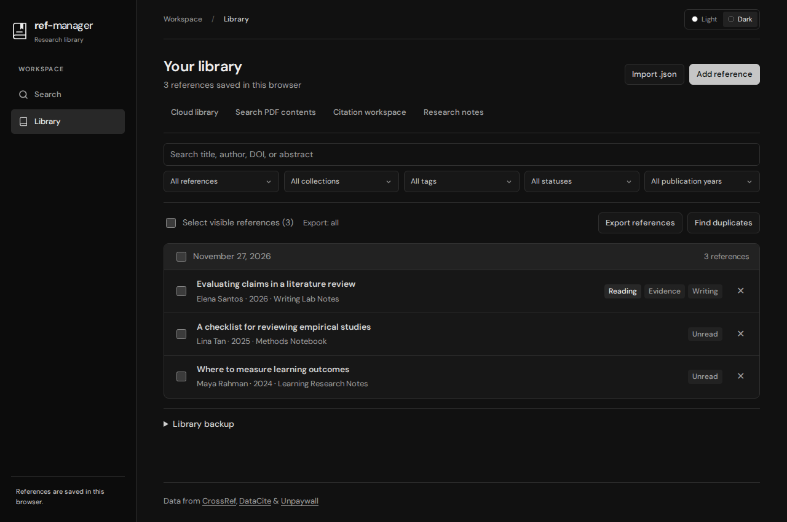
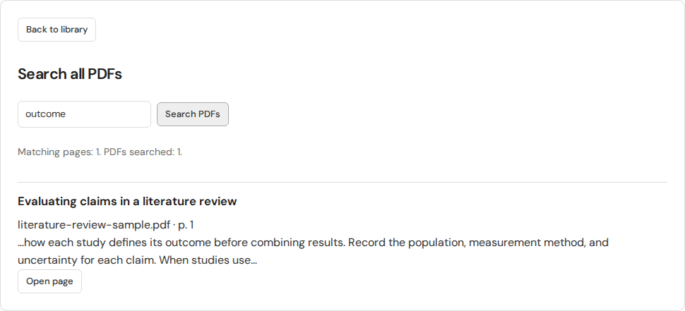
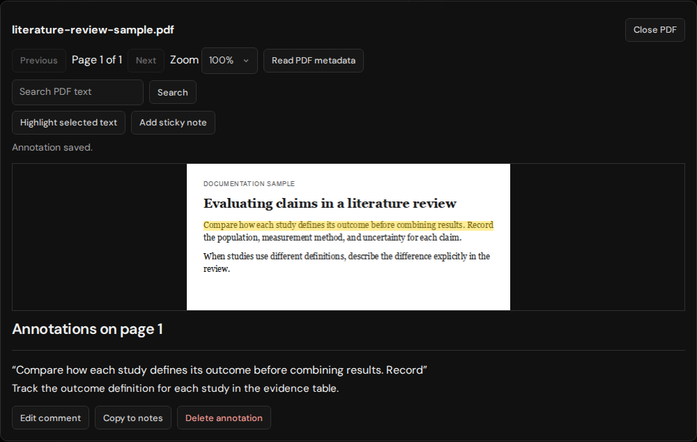
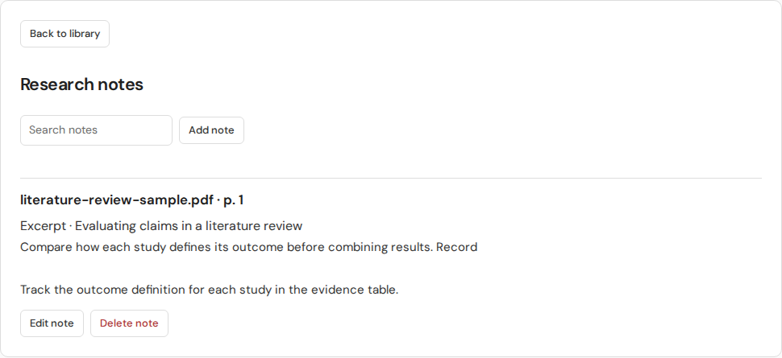
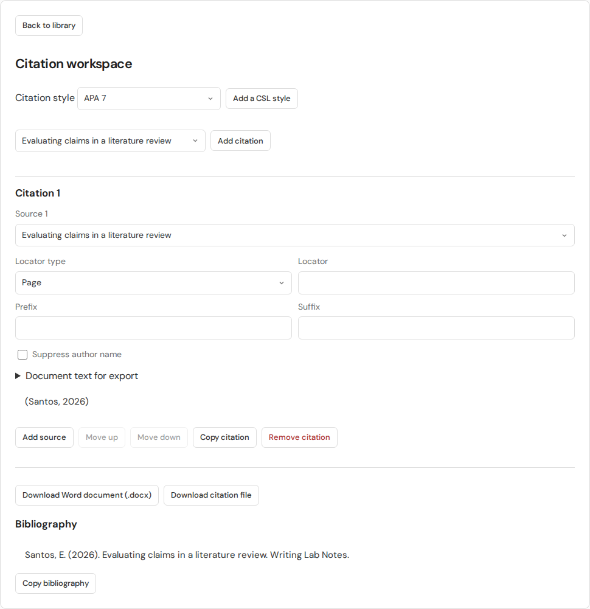
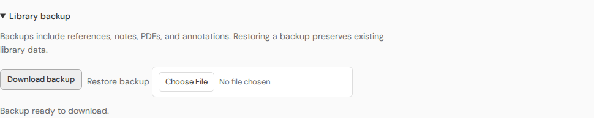

# Ref Manager

Ref Manager is a browser-based workspace for collecting references, reading and annotating PDFs, and preparing citations. The local library works without an account. An optional private cloud library lets you access cloud references and PDFs from another device.

[Open Ref Manager](https://ref-manager.alpaca.web.id)



## Feature guides

- [Collect, read, and organize references](docs/research-workflow.md) covers batch search, filters, PDF search, annotations, and linked research notes.
- [Prepare citations and send them to a document](docs/citation-workflow.md) covers citation groups, CSL, DOCX, and when to refresh or replace inserted citations.
- [Move and back up research data](docs/data-and-backups.md) explains the export formats, browser migration, cloud copies, and common recovery steps.

## Get started

1. Open **Search** and enter a DOI or paper title. **Batch** accepts up to 50 DOIs and titles, one per line. DOI lookup checks Crossref and falls back to DataCite. Title search uses Crossref. When available, Unpaywall provides an open-access link and Open Library provides a book cover.
2. Choose **Save to library**, or use **Library → Add reference** to enter a source manually.
3. Open a saved reference to edit it, attach a PDF, add a note, or copy a formatted bibliography entry.

The responsive interface uses a black and silver palette. The **Light / Dark** control follows your system preference until you choose a theme. Your choice is saved in the browser.

## Library, PDFs, and notes

- **Metadata.** Edit the reference type, title, authors, publication, publisher, year, volume, issue, pages, DOI, ISBN, source URL, and abstract. Organize entries with collections, tags, and the **Unread**, **Reading**, and **Read** statuses.
- **Filters.** Combine text search with collections, tags, reading status, publication year, or a built-in smart collection: **Recently added (30 days)**, **Unread**, **Without DOI**, and **Without local PDF**.
- **Duplicate review.** **Find duplicates** checks DOI, book ISBN, and similarities in title, author, and year. A merge keeps the chosen reference, fills missing fields, combines labels, and moves linked notes and attachments to it.
- **PDF reader.** Attach a local PDF and choose **Read PDF** to zoom, navigate pages, search text, highlight selections, or add comments and page notes. Use **Library → Search PDF contents** to search across local attachments. Text search and selection require a text layer. Scans without a text layer can be viewed as images. **Read PDF metadata** lets you review embedded title, author, and DOI before applying them. Annotations stay in Ref Manager. Downloading an attachment gives you the original PDF.
- **Research notes.** Save notes, insights, and excerpts on their own or link them to several references. **Copy to notes** turns a PDF annotation into a research note.



### Highlight a passage and save it to your notes

1. Open a reference and choose **Attach PDF → Read PDF**.
2. Select a passage and click **Highlight selected text**. Add a comment if useful, then choose **Save annotation**. For a comment about the whole page, choose **Add sticky note** instead.
3. Under **Annotations on page**, choose **Copy to notes** to save the passage and comment as a linked research note.





## Citations and document integrations

Reference details offer APA 7, IEEE, Harvard (Cite Them Right), and Chicago Author–Date bibliography entries. Open **Library → Citation workspace** to arrange citation groups in document order, cite multiple sources together, and add locators, prefixes, suffixes, or author suppression. The bibliography updates as you edit the draft, which is saved in the browser. Chicago Notes–Bibliography is available in the workspace for footnotes.

Copy formatted output with italics when the browser supports HTML clipboard data. Use **Add a CSL style** to import a `.csl` file or fetch a style by ID. Imported styles are available for the current workspace session. [CSL style catalog](https://www.zotero.org/styles)

**Download Word document (.docx)** creates an editable draft in the browser. Use **Document text for export** to add text before a citation. Note styles generate native Word footnotes. **Download citation file** creates a separate JSON bundle for the integrations below and is available for in-text styles.



| Integration | Supported workflow |
| --- | --- |
| [Microsoft Word](integrations/word/README.md) | Sideload the manifest from an HTTPS deployment. With WordApi 1.3 and a built-in in-text style, insert linked citations, then re-export the same draft and use **Refresh citations and bibliography**. Refresh follows the order in the document. WordApi 1.1, custom styles, and older bundles without linked data use plain-text insertion. |
| [Google Docs](integrations/google-docs/README.md) | Install the Apps Script sidebar in each editable document. Load the citation file to insert plain text at the cursor or append a bibliography. Replace inserted text manually when citations change. |
| [LibreOffice Writer](integrations/libreoffice/README.md) | Install the Python macros in your LibreOffice profile. Load the citation file to insert plain text at the cursor or append a bibliography. Replace inserted text manually when citations change. |

## Export and backup

| Option | What it contains |
| --- | --- |
| **Export references → BibTeX or RIS** | Bibliographic records for the selected references or the whole library when nothing is selected. |
| **Export references → JSON** | Reference metadata, collections, tags, and reading status. Use **Import .json** to bring these records into another library. |
| **Library → Library backup** | The local workspace, including reference records, research notes, PDF files, and annotations. On restore, matching records keep their metadata and gain any additional collection and tag memberships. |

Local data lives in IndexedDB in the current browser profile and site origin. Keep a workspace backup before clearing site data, changing domains, or moving to another browser. Online metadata lookup, open-access links, and fetching styles from the catalog require a connection.



## Optional cloud library

Open **Library → Cloud library** and sign in to a configured Supabase deployment. You can create cloud references or copy reference metadata between the local and cloud libraries. Copies are independent. The cloud side stores collections, tags, reading status, and one note per reference.

Cloud records are scoped to your account. The view shows when it last checked for updates and refreshes every 30 seconds while open, when you return to the tab, and after writes. If another edit changes the revision, the app keeps your draft and lets you compare overlapping fields before saving.

A cloud reference supports one private PDF up to 20 MB. Upload it from the cloud reference, then open it via a short-lived link or download it on another device. Remove its cloud PDF before deleting the reference. Use a workspace backup to transfer local PDF annotations and research notes. [Cloud setup and migrations](supabase/README.md)

## Run locally

Use Node.js 24 and npm.

```sh
npm ci
npm run dev
```

Open the URL printed by Vite. The local library works without environment variables. To enable the cloud library, configure a Supabase project, apply the repository migrations, and set `VITE_SUPABASE_URL` and `VITE_SUPABASE_PUBLISHABLE_KEY` in `.env.local`. [Environment template](.env.example)

The app uses React and Vite, Dexie over IndexedDB for browser storage, and PDF.js for reading attachments. Citation.js and citeproc format CSL styles, and `docx` generates Word files. Supabase provides optional email/password authentication, PostgreSQL storage, and private PDF storage.

## Checks

```sh
npm run lint
npm run test:citation
npm run test:metadata
npm run test:library
npm run test:word
npm run build
```

These checks cover citation styles, numbering and footnotes, local-to-cloud metadata round trips, library filtering and backups, conflict recovery, and Word citation refresh logic. `npm run test:cloud` separately checks account isolation, stale revisions, and private PDF access against a local Supabase stack. The Word tests exercise formatting and refresh logic in Node. Use a supported Word client to check sideloading and document insertion. [Local cloud test setup](supabase/README.md#test-locally)

## Deploy

`npm run build` writes the static app and the Word task pane to `dist/`. Use `npm run preview` to check the build locally. For a self-hosted deployment, serve the output over HTTPS to enable downloading the Word add-in manifest.

On Vercel, use the Vite preset and `dist` as the output directory. Set the optional cloud variables in the target environment before building. `vercel.json` disables automatic deployment for `dev`. For Git-based releases, use the production branch configured in the Vercel project. From a checkout linked to the correct project, you can also deploy directly with `vercel deploy --prod`. [Vite on Vercel](https://vercel.com/docs/frameworks/frontend/vite) · [Vercel CLI deploy guide](https://vercel.com/docs/cli/deploy)
