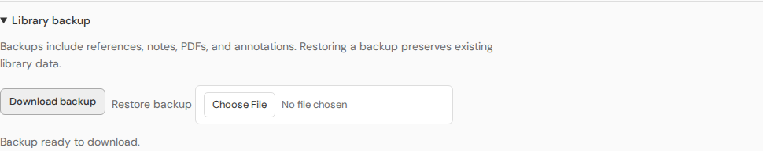

# Move and back up research data

[Back to README](../README.md)

## Pick the right file

| Task | Use |
| --- | --- |
| Share selected reference records | **Library → Export references → Export .json**. Select the records first. With no selection, the export includes the whole library. |
| Hand bibliographic data to another tool | Export **.bib** or **.ris**. These formats carry bibliography fields. |
| Move local references, notes, PDFs, and annotations | **Library → Library backup → Download backup**. |
| Insert citations into a writing app | **Citation workspace → Download citation file**. |

## Move to a new browser or site address

1. In the original browser, open **Library backup** and choose **Download backup**. Store the file somewhere you can access from the new browser.
2. Open Ref Manager at the destination and choose **Library backup → Restore backup**. Select the workspace backup file.
3. Check the counts in the restore message. Open a reference, a research note, and an annotated PDF to check the restored data before clearing anything at the source.

Local data belongs to the current browser profile and site origin. A different browser or domain starts with a separate library. Restoring a workspace backup keeps existing reference metadata, adds collection and tag memberships, and restores missing notes and attachments. Citation drafts and theme preferences are stored separately from the workspace backup.

## Use the cloud library on another device

1. Open **Library → Cloud library** and sign in. On a configured deployment, **Create a free account** starts email/password signup.
2. Choose a local entry and click **Copy reference to cloud**, or choose **Add cloud reference**. Open the cloud entry to change metadata, labels, reading status, or its cloud note.
3. To share a PDF across your own devices, upload it from the cloud entry. The limit is one PDF per reference, up to 20 MB. Open or download it while signed in. If opening a new tab is blocked, use **Download PDF**.
4. Sign in to the same account on the other device. Use **Save to this browser** if you want a local metadata copy. To annotate a cloud PDF locally, download it and attach it to that local entry.

Local and cloud copies are independent. For a full move that includes annotations and research notes, use a local workspace backup. The cloud note belongs to the cloud entry.

If another device saves while you are editing, the conflict screen preserves your draft and compares the overlapping fields. Choose **Use my values for conflicts** or **Keep latest values for conflicts** after reviewing the differences. Use **Continue editing draft** if you need to make more changes first.

## Troubleshoot

| What you see | What to check |
| --- | --- |
| The library looks empty | Open the original site address in the original browser profile or restore a backup. Clear the library filters if the reference count still shows saved items. |
| The JSON file is rejected | Use **Import .json** for reference exports, **Restore backup** for workspace backups, or the document integration for citation files. |
| Cloud sync is unavailable | Check the deployment's publishable key, project URL, and migration setup. Use the local library in the meantime. |
| Cloud data looks stale | Check **Last checked** and choose **Refresh** or **Retry refresh**. |
| A cloud reference cannot be deleted | If it has an attachment, choose **Delete cloud PDF** first. Refresh the reference before retrying after a revision conflict. |

[Supabase setup and local integration checks](../supabase/README.md)
